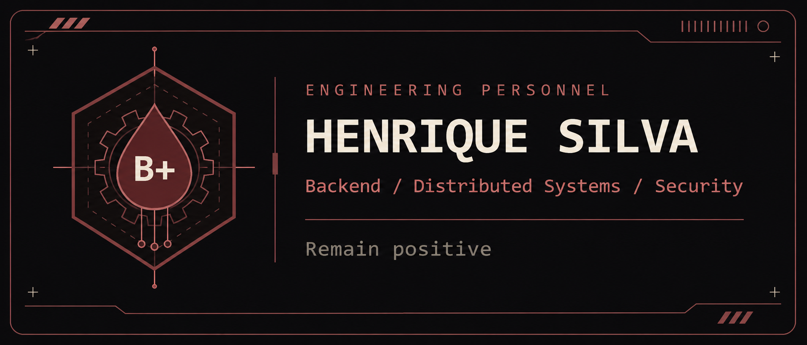
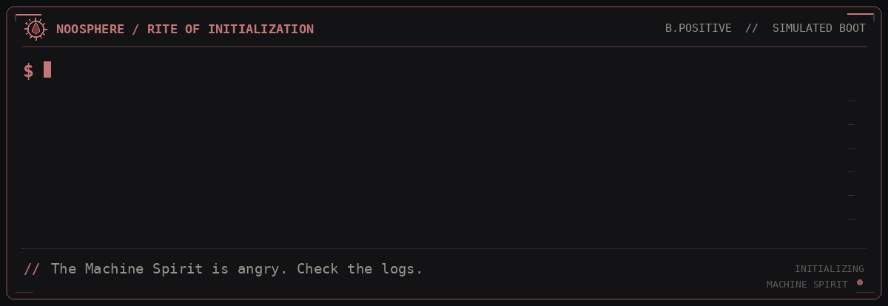
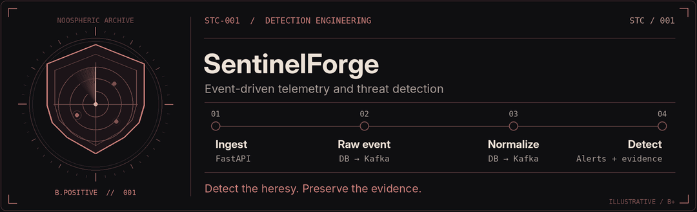
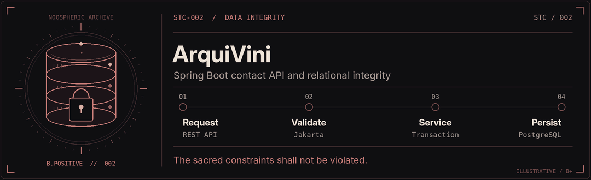
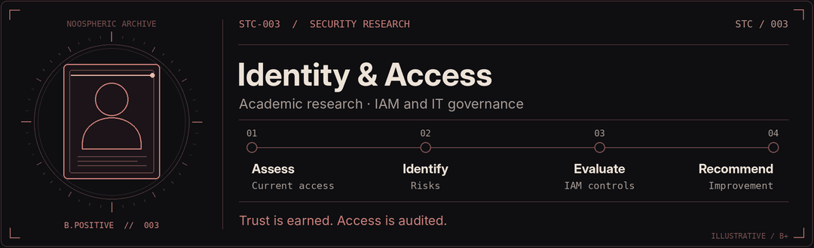
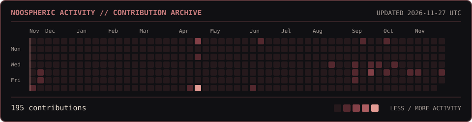

<div align="center">
  
</div>

<!-- You have accessed forbidden knowledge. The Omnissiah is watching. B.POSITIVE. -->

<div align="center">

`B.POSITIVE // NOOSPHERIC TERMINAL`

*Praise the Omnissiah. Run the tests.*

</div>



## 01 / Personnel record

I'm a **backend developer** focused on building reliable APIs, data-driven applications and event-driven services. My interests sit at the intersection of **backend engineering, distributed systems and security**.

I work with Python, Java, FastAPI, Spring Boot and PostgreSQL, with a particular interest in data integrity, asynchronous processing, automated testing and observability.

```toml
# /etc/noosphere/personnel.toml
[identity]
name = "Henrique Silva"
protocol = "B.POSITIVE"

[engineering]
reliability = true
data_integrity = "non-negotiable"
observability = "mandatory"
trust_user_input = false

[machine_spirit]
optimism = "eventually consistent"
```

## 02 / Sacred arsenal — Tech stack

| Domain | Technologies | Doctrine |
| :--- | :--- | :--- |
| Languages | Python · Java | Sacred languages |
| APIs & backend | FastAPI · Spring Boot | Invocation gateways |
| Persistence | PostgreSQL · SQLAlchemy · Spring Data JPA · Alembic | Sacred data vault |
| Messaging | Apache Kafka | Noospheric communications |
| Infrastructure | Docker · GitHub Actions | Containment and deployment rites |
| Quality | pytest · Ruff | Rites of validation |
| Observability | Prometheus · Grafana | Eyes of the Omnissiah |

*The flesh is weak. The database constraints are not.*

## 03 / Sacred constructs — Selected projects

### STC-001 · [SentinelForge — EDR Telemetry Lab](https://github.com/Henriquesilva0328/SentinelForge-EDR-Telemetry-Lab)

> Detect the heresy. Preserve the evidence.

An event-driven backend lab that simulates endpoint telemetry ingestion, normalization and threat detection. Raw events are persisted before being published to Kafka; workers normalize events and evaluate detection rules, producing alerts with structured evidence.



**Engineering highlights:**
- Secure ingestion, request validation, raw event persistence and audit trail.
- Kafka-based asynchronous processing and event normalization.
- Rule-based threat detection, structured alert evidence and replay-based validation.
- Prometheus metrics, Grafana observability, automated tests and CI.

`Python` · `FastAPI` · `Kafka` · `PostgreSQL` · `SQLAlchemy` · `Prometheus` · `Grafana`

[Explore the repository](https://github.com/Henriquesilva0328/SentinelForge-EDR-Telemetry-Lab) · [Architecture documentation](https://github.com/Henriquesilva0328/SentinelForge-EDR-Telemetry-Lab/blob/HEAD/docs/architecture.md)

---

### STC-002 · [ArquiVini — Backend & Data Integrity](https://github.com/Henriquesilva0328/arqui-vini)

> The sacred constraints shall not be violated.

A full-stack academic project based on a real client's need for an architecture portfolio and structured contact channel. The backend emphasizes layered validation, relational modeling and reliable persistence.



**Engineering highlights:**
- Spring Boot REST API, layered architecture and transactional service layer.
- Jakarta Bean Validation and standardized validation errors.
- PostgreSQL foreign keys, constraints, indexes and update triggers.
- Dockerized database and a Next.js frontend.

**Integration note:** the documented contact frontend validates its inputs but does not yet send the POST request to the API. The backend can be tested independently.

`Java` · `Spring Boot` · `PostgreSQL` · `JPA` · `Next.js` · `Docker`

[Explore the repository](https://github.com/Henriquesilva0328/arqui-vini)

---

### STC-003 · [IT Governance & Identity Management](https://github.com/Henriquesilva0328/TCC-Governanca-ti-gestao-identidades)

> One password for everyone. What could possibly go wrong?

Academic research at FATEC Barueri on the risks of shared credentials in computer laboratories, focusing on individual identification, traceability, access controls and privacy.



**Research scope:**
- Current-state assessment and risk analysis.
- Identity and access management requirements.
- Evaluation of authentication alternatives and governance controls.
- Recommendations and improvement planning; implementation is outside the current documented research phase.

`IAM` · `COBIT 2019` · `ISO/IEC 27001:2022` · `NIST SP 800-63-4`

[Explore the research](https://github.com/Henriquesilva0328/TCC-Governanca-ti-gestao-identidades)

## 04 / Sacred engineering doctrine

| Principle | In practice |
| :--- | :--- |
| Reliability | Explicit failure handling and automated tests |
| Data integrity | Validation at application and database layers |
| Observability | Structured logs, meaningful metrics and traceability |
| Security by design | Validate untrusted input and protect credentials |
| Simplicity | Use distributed components only when justified |

<details>
<summary>Restricted archive — technological heresy</summary>

```text
HTTP 403 — Access denied by the Inquisition.
HTTP 404 — Sacred knowledge lost in the Dark Age of Technology.
HTTP 500 — The Machine Spirit is displeased. Check the logs.
HTTP 503 — Performing sacred maintenance.
```

- The Omnissiah protects. Backups are still mandatory.
- Even the Machine God cannot resolve your merge conflicts.
- Hope is not a retry strategy.
- A microservice without a purpose is architectural heresy.
- B.Positive. Unless you're testing negative scenarios.

</details>

## 05 / Noospheric activity

*Every commit is a prayer. Every passing test is an answered one.*



<sub>Contribution calendar updated by GitHub Actions from GitHub data. Counts reflect the visibility and calendar semantics available to the workflow token; contributions are not exclusively commits.</sub>

## 06 / Pursuit of knowledge

Currently exploring event-driven architecture, distributed systems, database design, API security, detection engineering, identity management and observability.

<div align="center">
  
</div>